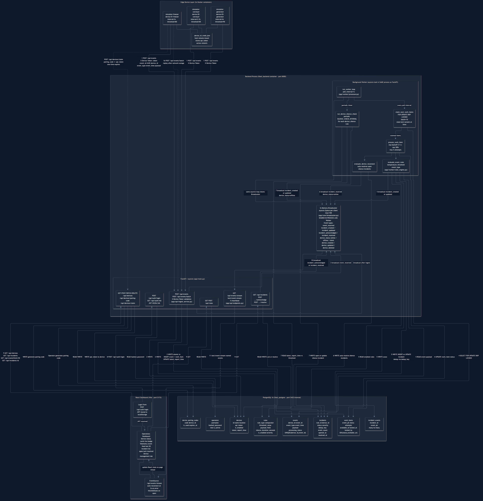

# Fleet Operations Platform  -  Real-time Edge Device Operations & Monitoring

A complete, resilient platform for monitoring a fleet of distributed devices, ingesting high-throughput telemetry, evaluating rules, deduplicating active incidents, providing a live real-time dashboard via Server-Sent Events (SSE), and simulating lossy edge device connectivity.

---

## Deliverables & Documentation

- **Evaluation & Run Instructions:** [run-instructions.md](run-instructions.md)  -  Prerequisites, first-time setup, start commands, multi-device simulator setup, and 5-minute evaluation walkthrough.
- **Architecture Notes:** [architecture-notes.md](architecture-notes.md)  -  Detailed rationale for key decisions, alternatives considered, trade-offs, and implementation status.
- **Architecture Diagram:** [architecture.png](architecture.png) / [architecture.mmd](architecture.mmd)  -  Visual component map and numbered end-to-end data flow.
- **Deployment Notes:** [deployment-notes.md](deployment-notes.md)  -  Production topology, monitoring, horizontal scaling, and security considerations.

---

## 1. Architecture & End-to-End Event Flow



> **Detailed Architecture Guide:** See [`architecture-notes.md`](architecture-notes.md) for full design rationale and [`architecture.mmd`](architecture.mmd) for the Mermaid flowchart source.

### System Components & Data Pipeline

| Layer | Component | Implementation Details |
|---|---|---|
| **1. Edge Layer** | Device Simulator (`simulator/`) | Generates periodic telemetry (`temperature`, `heartbeat`), models spikes, buffers offline bursts locally, and replays batches with stable UUIDs upon reconnect. |
| **2. Ingestion** | FastAPI REST API (`app/api/`) | Validates `X-Device-Token`, enforces monotonic `latest_report_time`, deduplicates events via `(device_id, event_id)`, and atomically inserts `Event` + `WorkItem` in one transaction. |
| **3. Queue & Storage** | PostgreSQL 16 (`app/models/`) | Durable relational outbox (`work_items`), immutable event archive, device registry, and incident state machine. |
| **4. Processing** | Background Worker (`app/worker/`) | Consumes `work_items` with `FOR UPDATE SKIP LOCKED`, evaluates threshold/event-type rules, performs periodic silence checks, and deduplicates active incidents via `dedup_key`. |
| **5. Live Broadcast** | Server-Sent Events (`/api/events/stream`) | Dispatches push notifications (`event_received`, `incident_created`, `device_status`) over bounded non-blocking queues with 15s keep-alive heartbeats. |
| **6. Dashboard** | React 19 + TypeScript (`frontend/`) | Real-time fleet health matrix, streaming event feed, incident management (acknowledge/resolve), and auto-reconciliation on reconnection. |

---

## 2. Server-Sent Events (SSE) Route & Reconnection Model

- **Endpoint Route:** `GET /api/events/stream`
- **Content-Type:** `text/event-stream`
- **Supported Event Types:**
  - `event_received`: Dispatched when an event is durably ingested.
  - `incident_created`: Dispatched when a new open incident is created.
  - `incident_updated`: Dispatched when repeated matching telemetry attaches to an active incident.
  - `incident_acknowledged`: Dispatched when an operator acknowledges an incident.
  - `incident_resolved`: Dispatched when an incident is resolved.
  - `device_status`: Dispatched when a device transitions between `online`, `offline`, or `silent`.
- **Replay / Reconnection Strategy:**
  - The SSE endpoint utilizes non-blocking memory-bounded subscriber queues to guarantee ingestion and worker performance is never compromised by slow browser clients.
  - **Reconnection Reconcile:** Instead of complex in-stream historical replay, the React frontend detects connection loss, displays a visible `RECONNECTING...` badge, and automatically issues a consolidated REST fetch to `/api/incidents`, `/api/devices`, and `/api/events` upon reconnection. This guarantees the UI recovers state from any offline gap.

---

## 3. Device Simulator & Offline Buffering

The simulator (`simulator/device_simulator.py`) demonstrates real-world edge telemetry conditions:
- **Registration & Pairing:** Generates pairing codes in the UI and claims them via `POST /api/devices/pairing/claim`.
- **Telemetry Generation:** Generates timestamped temperature readings with stable UUIDv4 event IDs.
- **Outage Simulation:** Simulates network outages by cutting off HTTP transmission and buffering events locally.
- **Reconnect & Batch Replay:** Replays all buffered events via `POST /api/events/batch` in configurable chunk sizes.
- **Deduplication:** Demonstrates idempotent resending of previously accepted events.

### Running the Simulator

```bash
uv run python -m simulator.device_simulator --duration 45 --interval 2 --threshold 85 --disconnect-at 10 --disconnect-duration 10
```

---

## 4. Local Setup, Run Instructions & Full Stack Demo

> **Comprehensive Guide:** See [`run-instructions.md`](run-instructions.md) for full step-by-step instructions, Docker options, and troubleshooting.

### Quick Start (Recommended Local Hybrid Run)

1. **Start PostgreSQL:**
   ```powershell
   docker run --name local_postgres -e POSTGRES_PASSWORD=postgres -e POSTGRES_DB=fleet_monitor -p 5432:5432 -d postgres:16-alpine
   ```
2. **Apply Migrations:**
   ```powershell
   uv run alembic upgrade head
   ```
3. **Start FastAPI Backend (Terminal 1):**
   ```powershell
   uv run uvicorn app.main:app --host 0.0.0.0 --port 8000 --reload
   ```
   *(The background worker automatically runs within the application lifespan, sharing the in-memory SSE Broadcaster).*
4. **Start Frontend Operations Dashboard (Terminal 2):**
   ```powershell
   cd frontend
   npm run dev
   ```
   Open `http://localhost:5173` in your browser. Default login: `admin` / `admin123`.

5. **Run Edge Device Simulator (Terminal 3):**
   ```powershell
   uv run python -m simulator.device_simulator --duration 60 --threshold 85 --disconnect-at 10 --disconnect-duration 10
   ```
   *(Or start all 3 pre-configured Docker simulators with `docker compose up -d simulator-freezer simulator-conveyor simulator-generator`).*

### Running Automated Test Suite

```powershell
uv run pytest -v
```
*(Verified: 27/27 tests passing).*

---

## 5. Demonstration Walkthrough

1. Open the dashboard at `http://localhost:5173`. Notice the **LIVE (SSE)** badge.
2. Start the simulator. The dashboard immediately reflects the device status in the **Fleet Devices** panel.
3. As normal telemetry is produced, watch the **Live Telemetry Event Feed** update in real time without page refreshes.
4. When a temperature reading exceeds the threshold (e.g., 75°C or 85°C), the worker immediately creates a **High Temperature Alert** incident under **Operational Incidents**.
5. Click on the incident row to open the **Incident Inspector Modal**, displaying the triggering event payload and measurement timestamp.
6. Click **Acknowledge** to take ownership of the ticket, then **Resolve** to close it with a resolution note.
7. During seconds 10-20 of the simulation, observe the simulator trigger an outage, buffer readings locally, reconnect at second 20, and replay the batch cleanly without losing telemetry or rolling back timestamps.

---

## 6. Production Deployment & Scaling Notes

> **Full Deployment Architecture:** See [`deployment-notes.md`](deployment-notes.md) for production topologies, health probes, metrics, and scaling constraints.

- **API Layer:** Stateless FastAPI containers deployed behind an Application Load Balancer (ALB) terminating TLS 1.3.
- **Worker Scaling:** Background workers scale horizontally; concurrent claiming is protected by PostgreSQL `FOR UPDATE SKIP LOCKED`.
- **Database:** Managed PostgreSQL (AWS RDS / GCP Cloud SQL) with point-in-time recovery and PgBouncer connection pooling.
- **Broadcaster in Multi-Instance Deployments:** Replace the current in-memory broadcaster with Redis Pub/Sub or PostgreSQL `LISTEN / NOTIFY` so all API replicas receive worker broadcast events.
